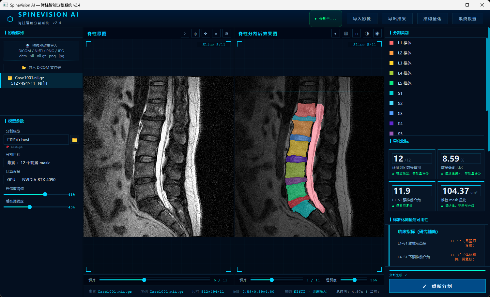
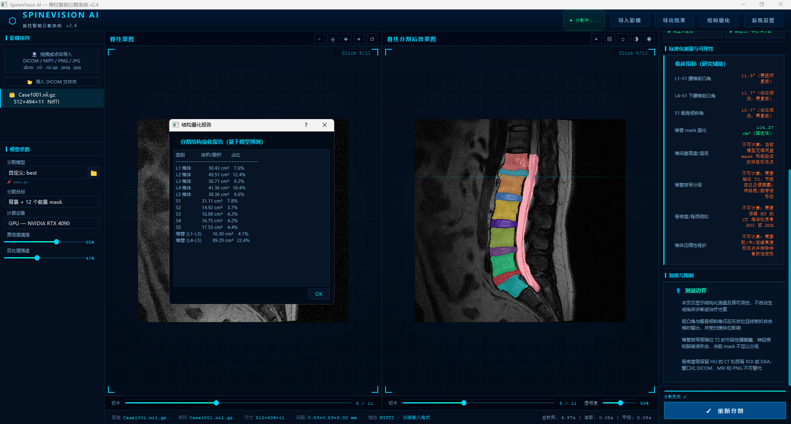
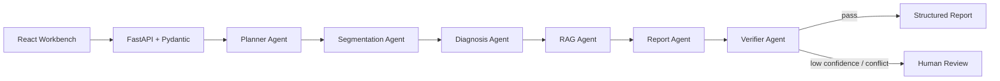

# SpineVision Agent Workbench

面向腰椎 MRI 研究场景的多 Agent 影像分析工作台。项目以 **LangGraph + ReAct** 编排 Planner、Segmentation、Diagnosis、RAG、Report、Verifier 六类 Agent，将 NIfTI 输入串联为 ROI 分割、病变候选识别、医学知识检索、结构化报告生成和一致性核验，并在低置信度或规则冲突时进入人工复核。

> 本项目仅用于科研与工程验证，不能替代放射科医师诊断或直接用于临床决策。

## 工作台能力

- 病例管理：上传 `.nii/.nii.gz`、查看执行状态、筛选待复核病例。
- MRI 阅片：服务端渲染切片，叠加多标签分割掩膜并调节透明度。
- Agent 追踪：展示 Planner 计划、工具调用、耗时、异常和重试状态。
- 诊断与证据：同步展示分类置信度、RAG Top-k 证据及来源。
- 报告复核：查看结构化 Findings/Impression，接受、修改或驳回草稿。
- 质量监管：集中展示 Verifier 发现的节段、数值和证据一致性问题。

## 界面预览

### 脊柱分割与量化工作台



### 结构量化报告



## 架构



后端内置六个可观测 Tool：影像检查、分割推理、诊断推理、知识检索、报告生成和一致性验证。每次调用均记录 Agent、输入摘要、状态、起止时间与错误码，供工作台和 Benchmark 使用。

## 快速启动

### 1. 后端

建议使用 Python 3.10：

```bash
python -m venv .venv
# Windows: .venv\Scripts\activate
# Linux/macOS: source .venv/bin/activate
pip install -r requirements-agent.txt
python run_agent_api.py
```

API 地址为 `http://127.0.0.1:8000`，Swagger 文档位于 `http://127.0.0.1:8000/docs`。

### 2. 工作台

建议使用 Node.js 22 和 pnpm 10：

```bash
cd workbench
cp .env.example .env.local
pnpm install
pnpm dev
```

浏览器打开终端显示的本地地址。前端也可在右侧设置面板中临时修改 API 地址。

## 接入自训练模型

通过环境变量切换后端实现：

```bash
set SPINEVISION_SEGMENTATION_BACKEND=local
set SPINEVISION_SEGMENTATION_CHECKPOINT=path/to/segmentation.ckpt
set SPINEVISION_CLASSIFIER_BACKEND=local
set SPINEVISION_CLASSIFIER_CHECKPOINT=path/to/classifier.ckpt
```

公开仓库不包含由医疗数据训练得到的模型权重和临床评估产物，分类默认使用 Mock 后端。运行真实推理前，请在本地提供分割/分类 checkpoint 与临床策略文件，并通过环境变量配置路径。模型适配入口位于 `spinevision_agent/tools/segmentation.py` 与 `spinevision_agent/tools/classification.py`。模型输出需遵循 Pydantic 数据契约，避免把自由文本直接传播到后续 Agent。

## 测试与评估

```bash
python -m unittest discover -s tests -v
python run_agent_benchmark.py

cd workbench
pnpm test
```

Benchmark 覆盖平均 Tool 调用次数、端到端耗时、RAG Recall@k、结构化字段正确率、Verifier 不一致检出率、异常恢复率及人工步骤压缩率。结果会写入 `agent_artifacts/benchmark/`；请只将真实复现实验结果用于简历或项目介绍。

## API 摘要

| 方法 | 路径 | 用途 |
| --- | --- | --- |
| `GET` | `/health` | 服务健康检查 |
| `POST` | `/cases/upload` | 上传 NIfTI 并创建病例 |
| `POST` | `/cases/{case_id}/run` | 执行完整 Agent 流程 |
| `GET` | `/cases/{case_id}/preview` | 获取 MRI/Mask 切片 PNG |
| `GET` | `/cases/{case_id}/trace` | 获取工具调用轨迹 |
| `POST` | `/cases/{case_id}/review` | 提交人工复核结论 |

## 数据与安全

- 上传前应完成 DICOM/NIfTI 去标识化，仓库默认忽略病例、掩膜和运行数据库。
- 不要提交患者姓名、住院号、原始 DICOM 头或可逆患者标识。
- 公开发布前请替换示例知识库中未经授权的内容，并核对模型权重和第三方数据许可。

## License

发布到 GitHub 前请按模型权重、训练数据和依赖许可选择许可证。若仅发布代码且无额外限制，可考虑 Apache-2.0；本仓库暂不代替项目所有者作出授权承诺。
